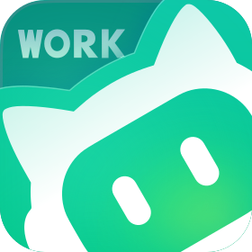

# WorkBuddy 接入平台

### 把 WorkBuddy 接进机器人的日常

模型接入、每日签到、积分查询，在 AstrBot 里一起打理。

[开始使用](#开始使用) · [使用指南](docs/USAGE.md) · [常用指令](#常用指令) · [下载](https://github.com/mydanyi/WorkBuddy-Access-Platform/releases/tag/v0.1.3)

将 WorkBuddy 接入 AstrBot，提供 OpenAI 兼容 API（普通/流式）、自动签到、成长任务一键执行与领奖、积分与模型倍率总览、模型列表定时刷新、主备模型按顺序调用，以及可配置管理员 QQ 的签到与异常通知。

支持单个 WorkBuddy（CN）账号，复用 AstrBot 原生 Provider，在插件设置和管理员私聊中管理。

## 在机器人里用上 WorkBuddy

### 像普通模型一样聊天

插件在本地开一个 OpenAI 兼容接口，普通响应和 SSE 流式都在其中。聊天请求里的历史、人格和 `tools` 只是原样转给上游，AstrBot 的 Provider 体系仍然是你在用的那一套，不需要换客户端，也没有额外的网页控制台。

### 模型名称后面直接看到倍率

在提供商里点一次「获取模型列表」，模型 ID 后面会跟着当前积分倍率和优惠标签，例如 `deepseek-v4.1-flash [0.11x]`、`hy3 [0x · 限时免费]`。倍率来自实时目录与活动配置；没有倍率信息的模型会标注「倍率未知」，并不等于免费，实际扣费仍以服务端结算为准。

目录默认每 60 分钟在本地自动刷新一次，可以关闭，也可以调整间隔。刷新只更新候选与标签，不会改写你已经保存的选择；关闭后，登录成功、`/wb status`、`/wb models` 和「获取模型列表」仍会照常读取。

### 主用失败时按顺序换下一个

开启「按顺序调用」后，模型列表会多出一个虚拟模型入口，候选用 AstrBot 原生多选下拉框从你账号的实时目录里挑选，标签上同时显示倍率与优惠。勾选顺序就是调用顺序：第一项为主用，其余依次备用。

只有在上游真实返回 `429` / `502` / `503` / `504`、并且还没有输出任何内容片段时，才会尝试下一项；一旦已经开始输出，就不会重播到备用模型，避免回复重复。换模型也不代表绕过账号级限流。

### 每天签到，顺手做完能做的任务

每日签到按配置时区自动执行，也可以手动 `/wb signin` 补一次；已签到时不会重复领奖。成长任务默认由管理员手动触发一轮，`/wb tasks run` 一键执行，`/wb tasks claim` 只领取已确认达标的奖励。

积分、进度和奖励都以服务端回读的确认结果为准：领取数量缺失、余额查询失败或到账数值未知时会显示「未知」，不会猜测，也不会虚报总数。只有已经实现了真实动作链的任务才会被执行，其余一律按人工处理。

### 一条 `/wb status` 看全部

在管理员私聊里执行 `/wb status`，可以一次查看登录、网关、积分、模型倍率、主备顺序与冷却、签到调度和成长任务进度。它本身不发起聊天、签到或领奖；某个查询失败只会单独提示，其它部分照常显示。

### 把结果告诉管理员

在插件配置里填写接收通知的管理员 QQ 并打开总开关，签到成功和异常会通过 QQ 机器人私聊发给你。签到消息包含本次实际领取的积分和当前可用总积分；同类异常在提醒间隔内只提醒一次，正常刷新授权、主动退出登录和取消任务都不会触发提醒。

## 开始使用

插件要求 **AstrBot `>=4.27.4,<5`** 与 **Python 3.12**，当前版本 **0.1.3**。

1. 在 AstrBot 中完成机器人平台连接；如需管理员 QQ 通知，请接好 QQ / OneBot v11（aiocqhttp）。
2. 安装插件：从本仓库放入 `data/plugins/astrbot_plugin_workbuddy/`（`main.py` 等文件应直接位于该目录），或从[发布页](https://github.com/mydanyi/WorkBuddy-Access-Platform/releases/tag/v0.1.3)下载 ZIP 解压安装，然后在管理面板重载插件。
3. 自行生成并设置主密钥 `WORKBUDDY_MASTER_KEY`（标准 base64、解码后恰好 32 字节），再设置网关密钥 `gateway.api_key`。主密钥环境变量需要对 AstrBot 进程生效，再保存插件配置并重载；生成与配置方法见[使用指南](docs/USAGE.md)。
4. 由管理员**私聊**执行 `/wb login` 取得链接，在**自己的浏览器**里完成授权。
5. 在 AstrBot 中添加 OpenAI 兼容 Provider：API Base 同一容器内默认为 `http://127.0.0.1:17863/v1`，密钥填 `gateway.api_key`。
6. 点「获取模型列表」并选择模型，再用 `/wb status` 检查登录、监听和积分状态。跨容器部署时，需要把 `gateway.host` 配成两端可互通的地址，细节见指南。

## 常用指令

以下指令都只响应**管理员私聊**，群聊或非管理员不会触发任何上游请求，也不会收到登录链接。

| 指令 | 作用 |
| --- | --- |
| `/wb status` | 只读总览：登录、网关、积分、模型与主备、签到、成长任务、通知 |
| `/wb login` | 获取登录链接，在浏览器完成后由插件后台确认 |
| `/wb models` | 列出可用模型、倍率、优惠标签与活动说明 |
| `/wb signin` | 手动签到一次 |
| `/wb tasks` | 只读列出成长任务 |
| `/wb tasks run` | 后台执行一轮成长任务 |
| `/wb tasks claim` | 后台领取已确认达标的奖励 |

`/wb help` 会列出全部指令，退出登录、积分汇总、任务状态等更多用法见[使用指南](docs/USAGE.md)。

## 按需调整

| 配置 | 默认 | 说明 |
| --- | --- | --- |
| `routing.enabled` | `false` | 开启后模型列表出现「按顺序调用」，按勾选顺序尝试主用与备用 |
| `model_refresh.enabled` / `interval_minutes` | `true` / `60` | 本地定时刷新模型目录，只影响候选与倍率标签 |
| `notifications.enabled` | `false` | 管理员 QQ 通知总开关，成功与异常可分别关闭 |
| `growth.auto_after_signin` | `false` | 开启后签到成功会在后台跑一轮成长任务 |
| `gateway.max_request_body_mb` | `16` | 本地请求体上限，超出直接返回 `413` |

其余默认值以插件设置页和 `_conf_schema.json` 为准，逐项说明见[使用指南](docs/USAGE.md)。

## 使用前了解这几件事

- 只支持**单个 WorkBuddy（CN）账号**，不合并多账号，也不是 WorkBuddy 客户端或桌面端替身。
- 这是**独立的非官方插件**，与腾讯没有任何背书关系，也不提供官方支持。
- 上游模型清单、任务活动与配额可能随服务端变化，插件只能按观测到的协议实现，不保证长期可用。
- 主备顺序调用只是本地选择策略，**不能**突破账号或 IP 级的限流与额度。
- 凭据加密不替代主机权限保护；主密钥、`gateway.api_key` 与账号长期安全请按指南处理。

## 致谢

感谢 [AstrBot](https://github.com/AstrBotDevs/AstrBot) 提供插件与 Provider 体系，也感谢这两个非官方开源项目的公开协议行为：

- [workbuddy2api-panel](https://github.com/linguo2625469/workbuddy2api-panel)（原始项目 [workbuddy2api](https://github.com/Sliverkiss/workbuddy2api)）
- [workbuddy-auto-signin](https://github.com/88lin/workbuddy-auto-signin)

本插件以 [MIT License](LICENSE) 开源，第三方许可原文与版权归因见 [THIRD_PARTY_NOTICES.md](THIRD_PARTY_NOTICES.md)。
