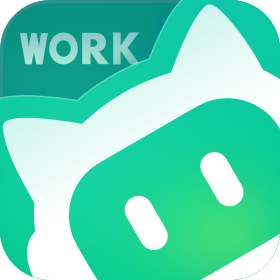

# WorkBuddy 接入平台

### 把 WorkBuddy 接进机器人的日常

聊天、签到、管理员通知，在 AstrBot 里一起打理。

[开始使用](#开始使用) · [使用指南](docs/USAGE.md) · [常用指令](#常用指令)

这个插件让 AstrBot 用上 WorkBuddy 的模型。聊天走的不是逆向出来的私有接口，而是官方
CodeBuddy CLI 的 ACP 通道——JSON-RPC over stdio，也就是官方允许的那种用法。CLI 装在
AstrBot 同一个容器里，插件按需把它拉起来，一个模型一条进程。

除此之外还有每日签到、主备模型按顺序调用，以及可配置管理员 QQ 的签到与异常通知。
只支持单个 WorkBuddy（CN）账号。

## 在机器人里用上 WorkBuddy

### 像普通模型一样聊天

插件在本地开一个 OpenAI 兼容接口，普通响应和 SSE 流式都在其中。历史、人格摊平成一段
prompt 交给 CLI，AstrBot 的 Provider 体系还是你在用的那一套，不用换客户端，也没有额外
的网页控制台。

有件事得先说清楚：这条路只走文本。请求里的 `tools` 不会被翻译成 CLI 的工具调用，历史里
`role="tool"` 的消息也会被丢掉，流里回来的只有正文和思考过程，没有 OpenAI 那种
`tool_calls`。所以把工具类插件挂在它后面不会生效。CLI 自己的工具是另一道开关（`--tools`，
默认关掉）。

### 模型清单从本机 CLI 里读

点「获取模型列表」时看到的是**这台机器上真正装的**模型：插件跑一次
`codebuddy --help`，从 `--model` 那一行读出清单；读不到就退回 CLI 自己的
`models.json`。不联网、不看账号、不需要登录。

清单只留在内存里，默认 60 秒保鲜，`/wb models` 随时可以重读。读不到就是空列表——
不会拿一份写死的模型名凑数。

### 主用失败时按顺序换下一个

开启「按顺序调用」后，模型列表会多出一个虚拟入口，勾选顺序就是调用顺序：第一项主用，
其余依次备用。

只有在上游真实返回 `429` / `502` / `503` / `504`、并且还没吐出任何正文时才会换下一个；
一旦开始出字就不重播，避免群里出现两遍回答。连续两个 `429` 会让整条路由进入冷却，
冷却期内的请求本地就拒掉，不去撞上游。换模型不代表绕过账号级限流。

### 一个模型一条进程

`--model` 是进程启动参数，协议里没有「换模型」这种请求，所以想用哪个模型就得有哪条
进程。插件按需懒启动，空闲的会被收掉，同时常驻的条数由 `acp.max_processes` 控制，
默认 2 条。正在出字的那条永远不会被淘汰——杀掉一个正在回答的进程，比多占几十兆内存
严重得多。

内置工具默认是关的（`acp.tools` 留空）。群里的消息永远不能驱动服务器执行命令。

### 每天签到

每日签到按配置时区自动跑，也可以手动 `/wb signin` 补一次；已经签过不会重复领奖。
登录态从 CLI 自己的凭据文件里读，不需要你再填一次 token。

签到失败会自动重试，超过当日上限就暂停，恢复用 `/wb signin resume`。

### 一条 `/wb status` 看全部

在管理员私聊里执行 `/wb status`，可以一次看到就绪状态、登录态、CLI 进程、监听端口、
签到调度、通知开关、模型清单和主备顺序。它本身不发起聊天、不签到、不领奖；某个查询
失败只会单独提示，其它部分照常显示。

### 把结果告诉管理员

填好接收通知的管理员 QQ 并打开总开关，签到成功和异常会通过 QQ 机器人私聊发给你。
同类异常在提醒间隔内只提醒一次。正常刷新授权、主动退出登录都不会触发提醒。

## 开始使用

插件要求 AstrBot `>=4.27.4,<5` 与 Python 3.12。

1. 在 AstrBot 的容器里装 Node 和 CLI：`npm i -g @tencent-ai/codebuddy-code`。
   CLI 必须和 AstrBot 在同一个容器里——插件是 spawn 它，不是连它。
2. 把插件放进 `data/plugins/astrbot_plugin_workbuddy/`（`main.py` 等文件直接在这个
   目录下），或者在管理面板里上传 ZIP，然后重载插件。
3. 打开插件设置，给 `gateway.api_key` 填一个够长的随机串。这是 Provider 要用的密钥。
4. 管理员**私聊**机器人执行 `/wb login`，点返回的链接在浏览器里完成登录。链接有时效，
   过期就再发一次。
5. 在 AstrBot 里添加 OpenAI 兼容 Provider：API Base 填 `http://127.0.0.1:17863/v1`
   （同容器），密钥填上一步的 `gateway.api_key`。
6. 点「获取模型列表」挑模型，再用 `/wb status` 确认登录、监听都正常。

跨容器部署时，把 `gateway.host` 改成两端都能访问的地址，别用 `127.0.0.1`。细节见
[使用指南](docs/USAGE.md)。

## 常用指令

以下指令只响应**管理员私聊**，群聊或非管理员不会触发任何上游请求，也拿不到登录链接。

| 指令 | 作用 |
| --- | --- |
| `/wb status` | 只读总览 |
| `/wb login` | 取登录链接，浏览器里完成后插件自己收尾 |
| `/wb logout` | 退出登录，同时删掉凭据 |
| `/wb models` | 列出本机 CLI 认的模型 |
| `/wb signin` | 手动签到一次 |
| `/wb signin resume` | 恢复被暂停的签到 |

`/wb help` 会把上面这些再列一遍。

## 按需调整

| 配置 | 默认 | 说明 |
| --- | --- | --- |
| `acp.cli_path` | `codebuddy` | CLI 可执行文件；不在 PATH 里就写绝对路径 |
| `acp.model` | 空 | 不指定时用 CLI 自己的默认模型 |
| `acp.max_processes` | `2` | 同时常驻的 CLI 进程数上限 |
| `gateway.api_key` | 空 | 网关密钥，**必须填**，否则监听不会开 |
| `routing.enabled` | `false` | 开启后模型列表出现「按顺序调用」 |
| `routing.first_frame_timeout` | `90` | 整轮等待首帧的总期限（秒）；超时不再切换备用 |
| `signin.enabled` | `true` | 每日自动签到 |
| `notifications.enabled` | `false` | 管理员 QQ 通知总开关 |
| `gateway.max_request_body_mb` | `16` | 请求体上限，超出直接返回 `413` |

其余默认值以插件设置页和 `_conf_schema.json` 为准，逐项说明见[使用指南](docs/USAGE.md)。

## 使用前了解这几件事

- 只支持**单个 WorkBuddy（CN）账号**，不合并多账号，也不是 WorkBuddy 客户端替身。
- 这是**非官方插件**，与腾讯没有背书关系，也不提供官方支持。
- 凭据存在容器里 CLI 自己的目录下。容器重建会丢，需要重新 `/wb login`；要留住就挂卷。
- CLI 的模型清单、配额与可用性随服务端变化，插件只能按观测到的行为实现，不保证长期可用。
- 主备顺序调用只是本地选择策略，**不能**突破账号或 IP 级的限流。

## 致谢

感谢 [AstrBot](https://github.com/AstrBotDevs/AstrBot) 提供插件与 Provider 体系。

签到这一段仍然走平台的私有接口，协议行为参考了这两个非官方开源项目：
[workbuddy2api-panel](https://github.com/linguo2625469/workbuddy2api-panel)（原始项目
[workbuddy2api](https://github.com/Sliverkiss/workbuddy2api)）与
[workbuddy-auto-signin](https://github.com/88lin/workbuddy-auto-signin)。

本插件以 [MIT License](LICENSE) 开源，第三方许可原文与版权归因见
[THIRD_PARTY_NOTICES.md](THIRD_PARTY_NOTICES.md)。
